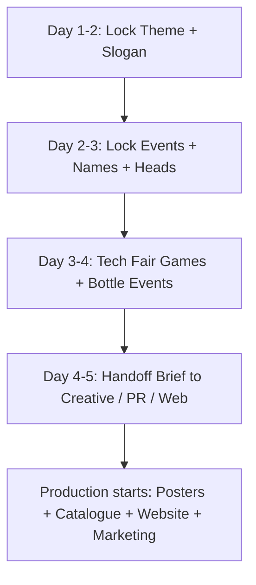

# ICON — Team Brief (THIS WEEK: 4–5 Days)

**Share this with everyone now.**  
We do **not** have weeks to decide. We have **4–5 days** to lock the idea so Creative, PR, and Web can start immediately.

---

## 1) What must be DONE by end of this week

By Day 5, these must be **final** (not “almost”):

1. **Theme + slogan** locked  
2. **Event list** locked (what will run)  
3. **Event names** locked (theme-linked titles)  
4. **Event head** for every event (name + phone)  
5. **Tech Fair mini-games** shortlist locked (6–8)  
6. **Bottle events** list ready (3–5 backups)  
7. **Design brief** handed to Creative + PR + Web  

If these 7 are not locked this week → posters, marketing, catalogue, and website all slip.

---

## 2) The flow (do not skip)

```text
Day 1–2: THEME + SLOGAN
        ↓
Day 2–3: EVENTS LIST + NAMES + OWNERS
        ↓
Day 3–4: TECH FAIR GAMES + BOTTLE EVENTS
        ↓
Day 4–5: HANDOFF TO CREATIVE / PR / WEB
        (they start production immediately)
```



---

## 3) Day-by-day plan (4–5 days)

### Day 1 — Theme decision
**Owner:** Admin + seniors  
**Done means:**
- [ ] Theme family chosen  
- [ ] Final theme name chosen  
- [ ] Final slogan chosen  
- [ ] Written in group + announced to Creative/PR/Web  

**Output message:**  
`THEME LOCKED: <name> | SLOGAN: <line>`

---

### Day 2 — Core events lock
**Owner:** Admin + all Event Heads  
**Done means:**
- [ ] Keep list confirmed (Hackathon, Gallery, Tech Fair, Football, Pickleball, FIFA, Chess, Treasure Hunt, extras)  
- [ ] Drop list confirmed (what we will NOT do)  
- [ ] Each event has an Event Head  
- [ ] Rough Day 1 / Day 2 placement agreed  

**Output:** Master event sheet (name temporary OK if final titles come Day 3)

---

### Day 3 — Theme-based names + Tech Fair
**Owner:** Event Heads + Tech Fair Head  
**Done means:**
- [ ] Final public event titles (theme-linked)  
- [ ] 6–8 Tech Fair mini-games named + 1-line rules  
- [ ] Gift hampers policy confirmed (**no cash** for mini-games)  
- [ ] 3–5 bottle events listed with owner  

**Output:**  
`EVENTS LOCKED` list + `TECH FAIR GAMES LOCKED` list

---

### Day 4 — Details freeze for designers/web
**Owner:** Each Event Head  
For every event, fill:
- [ ] One-line description  
- [ ] Team size  
- [ ] Fee (if any)  
- [ ] Prize / recognition note  
- [ ] Preferred time + venue  
- [ ] 5–8 rules (draft OK)  

**Output:** Content sheet Creative + Web can use without chasing people

---

### Day 5 — Handoff + kickoff production
**Owner:** Admin  
**Done means:**
- [ ] One handoff brief sent to Creative, PR, Web  
- [ ] Poster list decided (which events get flex)  
- [ ] Website IA confirmed (Home / Events / Schedule / Register)  
- [ ] Registration fields draft approved  
- [ ] Next week owners for design/web deadlines set  

**After Day 5:** no more theme/event-name changes unless emergency.

---

## 4) Who does what THIS WEEK

| Role | This week only |
|------|----------------|
| **Admin** | Drive decisions daily; lock theme; publish final lists; handoff brief |
| **Seniors** | Approve theme + final event spine within 48 hrs |
| **Event Heads** | Confirm run/drop; propose names; rules draft; bottle event |
| **Tech Fair Head** | Lock 6–8 mini-games + materials + hamper needs |
| **Creative** | Prepare templates; start posters the hour names are locked |
| **PR / Marketing** | Prepare teaser → theme reveal → event drop plan (post only after lock) |
| **Web** | Prepare page structure; wait for locked content; then fill fast |

---

## 5) Non-negotiable rules

1. **No poster final** before theme lock.  
2. **No event marketing** before event-name lock.  
3. **No website copy freeze** before Day 4 details.  
4. **Max 1 decision meeting per day** (30–45 mins). Rest is async updates.  
5. After Day 5, changes need Admin + Senior approval.

---

## 6) Master checklist (tick in group)

**By Day 2**
- [ ] Theme locked  
- [ ] Slogan locked  

**By Day 3**
- [ ] Events locked  
- [ ] Event names locked  
- [ ] Event heads assigned  
- [ ] Tech Fair games locked  
- [ ] Bottle events locked  

**By Day 5**
- [ ] Event detail sheet filled  
- [ ] Creative brief sent  
- [ ] PR plan ready to post  
- [ ] Web content ready to build  
- [ ] Registration fields drafted  

---

## 7) Paste this in the team group NOW

> Team — timeline correction: we have **4–5 days this week** to lock everything that blocks design/marketing/website.  
>  
> **Order:** Theme → Events + names → Tech Fair games + bottle events → Handoff to Creative/PR/Web.  
>  
> End of this week we must be clear on the full idea. After that, production starts (posters, catalogue, website, registration).  
>  
> Event heads: today start confirming your event (run/drop), and Tech Fair head start mini-game list. Rewards for mini-games = **gift hampers**, not cash.  
> Full day-wise plan: `docs/admin-decisions/05_TEAM_BRIEF_45_DAYS.md`

---

## 8) Handoff brief template (send on Day 5)

```text
ICON HANDOFF BRIEF — <date>

THEME: 
SLOGAN: 

EVENT LIST (final names):
1.
2.
3.

TECH FAIR GAMES:
1.
2.

BOTTLE EVENTS:
1.
2.

DESIGN NOTES:
- Colours / mood:
- Must-have flex list:

WEB NOTES:
- Pages needed:
- Registration fields:

OWNERS:
- Creative:
- PR:
- Web:
- Admin contact:
```

---

## Related
- Themes: `01_THEME_AND_SLOGANS.md`  
- Events keep/extra: `02_EVENTS_CATALOG.md`  
- Tech Fair + bottle ideas: `06_TECH_FAIR_BOTTLE_EVENTS.md`  
